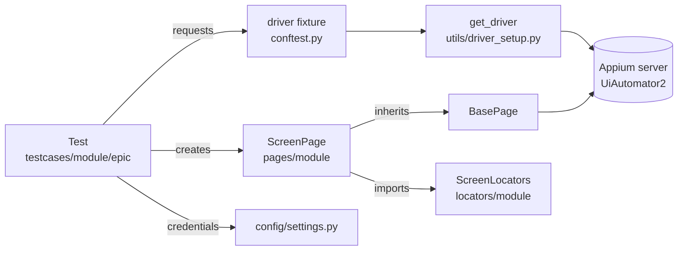

# ARCHITECTURE.md: UBL Digital Android Automation

**Purpose:** a Page Object Model framework (Python, pytest, Appium UiAutomator2) for
automating the UBL Digital Android app, organised by the module sheet's Module → Epic →
Sub-feature hierarchy.

_Last reviewed against commit `a64d580` (2026-11-11). Update via the `session-handoff` skill._

---

## 1. Folder structure

```
Appium_Automation_Project_Android/
├── AGENTS.md                    agent rules (SHARED block + Android section)
├── ARCHITECTURE.md / ENVIRONMENT.md / TEST_AUTOMATION_STATUS.md / DECISIONS.md
├── .agents/
│   ├── skills/                  android-locators, page-object, pytest-journey-test,
│   │                            debug-appium-failure, testability-request, session-handoff
│   └── workflows/new-journey.md
├── .env.example                 template: UBL_USERNAME=, UBL_PASSWORD= (real .env is gitignored)
├── conftest.py                  root driver fixture
├── pytest.ini                   testpaths, pythonpath, strict markers
├── requirements.txt             pinned dependencies
├── report.py                    HTML report builder (not connected, see section 8)
├── config/settings.py           .env reader, get_credentials(), Settings
├── utils/driver_setup.py        ANDROID_CAPS, get_driver()
├── reports/format_report_engine.py   second HTML report builder (not connected)
├── locators/<module>/           one *_locators.py per screen
├── pages/base_page.py
├── pages/<module>/              one *_page.py per screen
└── testcases/
    ├── test_00_driver_smoke.py
    └── <module>/
        ├── conftest.py          module start-screen fixture (placeholder)
        └── <epic>/test_<epic>_<subfeature>.py
```

### Modules and epics (`testcases/`)

| Module | Epic folders |
|---|---|
| pre_signin | login, pre_signin_services |
| dashboard | menu, global_search, ai_voice_command |
| payments | pay_anyone, bills_payments, mobile_payments, qr_pay, donations_zakat, payment_requests, beneficiary_mgmt, schedule_payments, remittance, digital_invoice, currency_exchange |
| accounts | mini_statement, account_statement, card_management, digital_transactions, certificates, self_transfer, cheque_management, list_of_accounts, withholding_tax, saving_investments |
| side_menu | manage, accounts_payments, security_access, notifications_alerts, appearance_motion, help_information |
| account_opening | mukammal_account, rda_account, smart_account |
| services | car_loan, deals_discounts |

`locators/` and `pages/` use the same module folders, with screen files flat inside each
(for example `pages/payments/pay_anyone_page.py`). Extra hub screens:
`account_opening_page.py`, `services_page.py`.

**Shared components** (`pages/components/`, `locators/components/`): account_selector,
beneficiary_picker, biller_list, bottom_nav, dialog, otp, receipt.

---

## 2. Layers and dependency direction



- Tests use pages only. They never import locators or call `driver.find_element`.
- Pages hold the actions and state checks and never assert. Tests assert.

---

## 3. Naming conventions

| Item | Pattern | Example |
|---|---|---|
| Locator file / class | `<screen>_locators.py` / `<Screen>Locators` | `pay_anyone_locators.py` / `PayAnyoneLocators` |
| Page file / class | `<screen>_page.py` / `<Screen>Page` | `pay_anyone_page.py` / `PayAnyonePage` |
| Component class | `<Name>ComponentPage` / `<Name>ComponentLocators` | `OtpComponentPage` |
| Test file | `test_<epic>_<subfeature>.py` (single-file epics: `test_<epic>.py`) | `test_pay_anyone_ibft.py` |
| Locator constant | `UPPER_SNAKE` tuple `(AppiumBy.X, "value")` | `TITLE = (AppiumBy.XPATH, "//TODO_…")` |

---

## 4. Driver lifecycle

1. A test requests the `driver` fixture (root `conftest.py`, **function scope**).
2. The fixture calls `get_driver(platform="android")`, which loads `ANDROID_CAPS`
   into `UiAutomator2Options` and opens `webdriver.Remote("http://127.0.0.1:4723")`.
3. `yield` hands the driver to the test.
4. `finally:` calls `driver.quit()`. A failed quit is currently ignored silently.

Every test gets a new session (isolation over speed). `noReset: true` keeps app data,
which device binding requires.

**Known gaps:** `appium:udid` is commented out. `get_driver()` imports `XCUITestOptions`
without using it, and calling it with any platform other than "android" fails
(`options` is never set).

---

## 5. BasePage (`pages/base_page.py`)

| Method | Purpose | Parameters | Returns |
|---|---|---|---|
| `__init__` | Stores driver, timeout and a `WebDriverWait` | `driver`, `timeout=15` | — |
| `find_element` | Waits for presence | `locator` | WebElement |
| `click_element` | Waits until clickable, clicks | `locator` | None |
| `type_text` | Clears and types; `sensitive=True` prepares `[REDACTED]` (not yet logged) | `locator`, `text`, `sensitive=False` | None |
| `is_element_displayed` | Waits for visibility; True/False | `locator` | bool |
| `tap_coordinate` | W3C tap at x,y (last resort) | `x`, `y` | None |
| `long_press_bypass` | **iOS** `mobile: touchAndHold` (TODO: Android) | `x`, `y`, `duration=5.0` | None |

**Not yet present:** get_text, scroll, swipe, keyboard handling, logging, screenshots.

---

## 6. Locators

- Stored as class attributes holding `(AppiumBy.<strategy>, value)` tuples, one class per screen.
- Current state: placeholders (`//TODO_…`), two iOS class names in login, and guessed
  accessibility IDs in schedule payments. **No locator has been taken from Android page source yet.**
- Target priority: resource-id → accessibility id → UiAutomator → XPath (see AGENTS.md A3).

---

## 7. Configuration and secrets

```
.env (gitignored) ──> config/settings.py
                       ├── get_credentials()  → {"username", "password"}
                       │     reads ONLY the .env file; raises RuntimeError if missing
                       └── Settings           → non-secret defaults (server URL, package,
                                                activity, device name, UDID) from shell env
```

- `.env.example` lists `UBL_USERNAME` and `UBL_PASSWORD` only.
- `Settings` is **not used** by `utils/driver_setup.py`, which has its own hard-coded
  `ANDROID_CAPS` (known duplication).
- `get_credentials()` reads the file, not shell environment variables. A CI pipeline would
  need a `.env` file or a change to this function.

---

## 8. Reporting and logging (current state)

| Item | State |
|---|---|
| `report.py` → `generate_html_report()` | Exists; writes `./report.html`; **not called anywhere** |
| `reports/format_report_engine.py` → `generate_isolated_report()` | Exists; **not called anywhere** |
| Device label in both | Defaults to "iPhone 17 (iOS 26.0.1)" |
| Logging | None (`print()` in `login_page.py` and `driver_setup.py`) |
| Failure screenshots / page source | None |
| pytest output | `-ra` short summary (`pytest.ini`) |

---

## 9. Agent tooling

- `AGENTS.md`: a SHARED block (kept identical with the iOS repo) and an Android section.
- `.agents/skills/`: android-locators, page-object, pytest-journey-test,
  debug-appium-failure, testability-request, session-handoff.
- `.agents/workflows/new-journey.md`: `/new-journey` chains locators → page → tests → status update.
